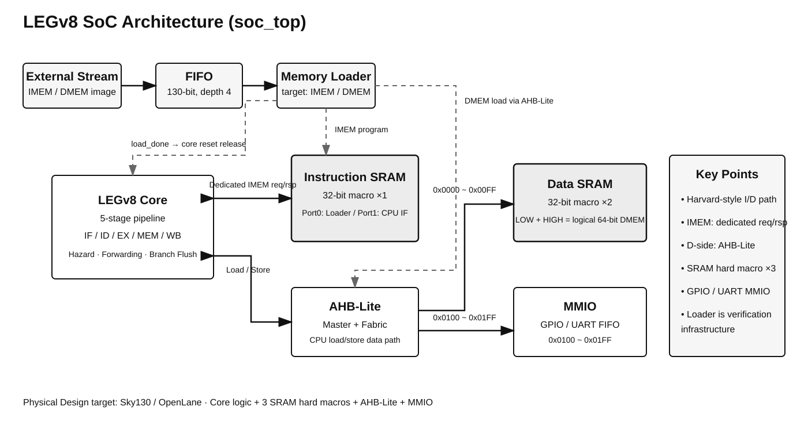

# LEGv8 5-Stage Pipelined CPU SoC

LEGv8 기반 5-stage pipelined CPU를 출발점으로 **SRAM hard macro, AHB-Lite data bus, MMIO, external image loader**를 결합한 소형 SoC 프로젝트입니다.

프로젝트의 중심은 CPU 기능 확장 자체보다, 직접 구성한 RTL을 대상으로 **Sky130 기반 RTL-to-GDSII / Physical Design / STA를 수행하고 논리 구조와 물리 구현 결과의 관계를 분석하는 것**입니다.

<p align="center">
  
</p>

## Project Summary

- LEGv8 5-stage pipeline: `IF / ID / EX / MEM / WB`
- Load-use hazard detection 및 pipeline stall
- EX/MEM, MEM/WB forwarding
- EX-stage branch resolution 및 taken branch flush
- Dedicated instruction-memory request/response path
- AHB-Lite 기반 CPU load/store data path
- Sky130 SRAM hard macro 3개 사용
  - IMEM: 32-bit SRAM x1
  - DMEM: 32-bit SRAM x2 병렬 구성 -> logical 64-bit
- Memory-mapped GPIO / UART
- External image stream -> FIFO -> Loader 기반 simulation loading infrastructure
- `load_done` 이후 CPU 실행 시작
- Sky130/OpenLane 기반 synthesis, floorplan, macro placement, CTS, routing, STA 진행

---

## `soc_top` Architecture

현재 `soc_top`은 CPU core, instruction SRAM, AHB-Lite bus, data SRAM, MMIO, image loader를 하나의 SoC 계층으로 통합합니다.

```text
soc_top
|
+-- simple_fifo load_fifo
|   +-- external image packet buffering
|
+-- memory_loader loader
|   +-- target=0 -> IMEM programming path
|   +-- target=1 -> AHB-Lite -> DMEM programming path
|
+-- core
|   +-- LEGv8 5-stage pipelined CPU
|
+-- sram_wrapper32b instruction_sram
|   +-- SRAM_IMEM : 32-bit SRAM macro x1
|
+-- ahb_lite_master ahb_master
|   +-- loading phase : Loader owns master
|   +-- runtime phase : CPU owns master
|
+-- ahb_lite_fabric ahb_fabric
|   +-- DMEM backend
|   +-- MMIO backend
|
+-- sram_wrapper64b data_sram
|   +-- SRAM_LOW  : 32-bit SRAM macro x1
|   +-- SRAM_HIGH : 32-bit SRAM macro x1
|
+-- mmio_subsystem mmio
    +-- mmio_gpio
    +-- mmio_uart
```

### Top-Level Data Flow

`soc_top`의 동작은 **loading phase**와 **runtime phase**로 나뉩니다.

```text
Loading Phase

External Memory Stream
        |
        v
   130-bit FIFO
        |
        v
   Memory Loader
      /      \
     /        \
IMEM path    AHB-Lite path
   |             |
   v             v
IMEM SRAM      DMEM SRAM

load_done = 1
      |
      v
CPU reset release
```

```text
Runtime Phase

Instruction side
CPU IF <---- dedicated req/rsp ----> IMEM SRAM

Data side
CPU LOAD/STORE
      |
      v
AHB-Lite Master
      |
      v
AHB-Lite Fabric
   /        \
  v          v
DMEM        MMIO
            /  \
         GPIO  UART
```

Instruction fetch와 load/store가 하나의 공유 bus를 사용하지 않는 **Harvard-style 구조**입니다. Instruction side는 전용 SRAM request/response interface를 사용하고, data side만 AHB-Lite를 통해 DMEM/MMIO에 접근합니다.

---

## CPU Core

CPU는 5-stage pipeline으로 구성됩니다.

```text
IF -> IF/ID -> ID -> ID/EX -> EX -> EX/MEM -> MEM -> MEM/WB -> WB
```

주요 기능:

- **Hazard Detection**: load-use dependency 발생 시 stall / bubble 삽입
- **Forwarding**: EX/MEM 및 MEM/WB 결과를 EX stage operand로 bypass
- **Branch Handling**: conditional / unconditional branch를 EX stage에서 처리
- **Flush**: taken branch 발생 시 younger sequential instruction 제거
- **Memory Wait**: DMEM transaction 완료 전까지 pipeline hold

Core의 memory interface는 두 경로로 분리됩니다.

```text
Instruction side
imem_req_addr
imem_req_valid / imem_req_ready
imem_rsp_valid / imem_rsp_ready
imem_rsp_addr
imem_rsp_data
imem_flush

Data side
dmem_addr
dmem_wdata
dmem_re / dmem_we
dmem_ready
dmem_rdata
```

---

## Instruction Memory

Instruction memory는 다음 Sky130/OpenRAM SRAM macro 1개를 사용합니다.

```text
sky130_sram_1kbyte_1rw1r_32x256_8
256 words x 32-bit = 1 KB
```

`sram_wrapper32b` 내부에서 두 physical port를 역할별로 분리합니다.

```text
Port 0 : Loader programming
Port 1 : CPU instruction fetch
```

CPU fetch path는 synchronous SRAM latency를 감추기 위해 request/response handshake와 response buffering을 사용합니다.

```text
CPU PC
  |
  | req_addr / req_valid
  v
SRAM Port 1
  |
  | synchronous read
  v
Response Buffer
  |
  | rsp_valid / rsp_data / rsp_addr
  v
CPU IF
```

Taken branch가 발생하면 `imem_flush`를 통해 outstanding sequential fetch response를 폐기합니다.

IMEM은 byte-addressed PC를 SRAM word index로 변환하기 위해 `addr[9:2]`를 사용합니다.

---

## Data Memory

CPU data path는 64-bit이며, physical SRAM macro는 32-bit이므로 동일한 SRAM 2개를 병렬로 구성합니다.

```text
                64-bit DMEM

[63:32] -> SRAM_HIGH : 32-bit
[31:0 ] -> SRAM_LOW  : 32-bit
```

따라서 SoC에 포함되는 SRAM hard macro는 총 3개입니다.

```text
IMEM       32-bit SRAM x1
DMEM LOW   32-bit SRAM x1
DMEM HIGH  32-bit SRAM x1
--------------------------
Total      32-bit SRAM x3
```

`sram_wrapper64b`는 CPU/AHB 측의 64-bit request를 두 SRAM macro에 동시에 전달하고, 두 32-bit output을 하나의 64-bit read data로 결합합니다.

현재 DMEM wrapper의 SRAM index는 기존 CPU regression의 memory-address semantics를 유지하기 위해 `addr[7:0]`을 사용합니다. 따라서 이 프로젝트의 DMEM addressing은 일반적인 64-bit byte-addressed memory의 `addr >> 3` mapping과 동일하지 않습니다.

---

## External Image Loading

Simulation에서는 프로그램과 초기 data image를 외부 stream으로 `soc_top`에 전달합니다.

Packet format:

```text
{ last, target, addr[63:0], data[63:0] }

width = 1 + 1 + 64 + 64 = 130 bits
```

`target` 의미:

```text
target = 0 : IMEM programming
target = 1 : DMEM programming
```

Loading path:

```text
External Stream
      |
      v
simple_fifo (130-bit, depth 4)
      |
      v
memory_loader
   /        \
  /          \
IMEM        AHB-Lite
Port 0        |
              v
             DMEM
```

모든 image loading이 끝나면 `load_done`이 올라가고:

```text
core_rst = rst | !load_done
```

조건에 의해 CPU reset이 해제되어 instruction execution이 시작됩니다.

이 loader는 **simulation / verification용 initialization infrastructure**이며 runtime instruction-fetch path 또는 실제 boot protocol은 아닙니다.

---

## AHB-Lite Data Bus

AHB-Lite는 CPU의 load/store 및 loader의 DMEM write를 data-memory/MMIO backend로 전달합니다.

### Master Ownership

```text
load_done = 0
Loader -> AHB-Lite Master

load_done = 1
CPU    -> AHB-Lite Master
```

Loader와 CPU가 동시에 bus ownership을 경쟁하는 구조가 아니라, loading/runtime phase에 따라 master input을 선택합니다.

현재 구현은 single-master / single-transfer 중심의 최소 AHB-Lite subset입니다.

주요 신호:

```text
HADDR
HTRANS
HWRITE
HSIZE
HBURST
HPROT
HMASTLOCK
HWDATA
HRDATA
HREADY
HRESP
```

### Fabric Decode

Runtime 기준 AHB fabric은 다음 address window를 decode합니다.

```text
0x0000 ~ 0x00FF : DMEM
0x0100 ~ 0x01FF : MMIO
```

Loading phase에서는 loader의 data transaction을 DMEM으로 전달합니다.

---

## MMIO

`mmio_subsystem` 내부에서 GPIO와 UART를 local address로 decode합니다.

| Address | Block | Description |
|---|---|---|
| `0x0000 ~ 0x00FF` | DMEM | 64-bit logical data memory |
| `0x0100` | GPIO_OUT | GPIO output register |
| `0x0108` | GPIO_IN | GPIO input register |
| `0x0110` | GPIO_OE | GPIO output-enable register |
| `0x0120` | UART_RXDATA | UART RX FIFO data |
| `0x0128` | UART_TXDATA | UART TX FIFO data |
| `0x0130` | UART_STATUS | RX valid / TX ready status |

### GPIO

GPIO는 내부적으로 64-bit register interface를 사용합니다.

```text
gpio_out[63:0]
gpio_in [63:0]
gpio_oe [63:0]
```

`gpio_oe = 1`이면 output, `gpio_oe = 0`이면 input 방향으로 사용합니다.

### UART

UART는 현재 bit-level serial PHY가 아니라 **MMIO + FIFO + byte-stream interface**까지 구현되어 있습니다.

```text
RX : uart_rx_valid / uart_rx_data / uart_rx_ready
TX : uart_tx_valid / uart_tx_data / uart_tx_ready
```

RX/TX FIFO depth는 각각 4입니다.

---

## Verification

Directed regression에서는 다음 항목을 확인합니다.

- Register result checking
- Load-use hazard
- Stall 발생 위치 및 횟수
- EX/MEM / MEM/WB forwarding
- Conditional branch taken / not-taken
- Unconditional branch
- Pipeline hold assertion
- Forwarding select legality
- Hazard stall control consistency
- SRAM hard macro wrapper integration
- AHB-Lite DMEM access

AHB-Lite integration 단계에서 directed regression **40/40 PASS** 기록을 확인했습니다.

대표 expected register result:

```text
x1  = 2
x2  = 3
x3  = 5
x4  = 3
x5  = 1
x6  = 3
x9  = 99
x10 = 11
x12 = 101
x13 = 98
x14 = 0
x15 = 17
x16 = 0
x20 = 21
x21 = 23
x22 = 24
x23 = 24
x24 = 26
```

---

## Repository Structure

```text
.
├── rtl/
│   ├── core.sv
│   ├── datapath.sv
│   ├── control.sv
│   ├── program_counter.sv
│   ├── register_file.sv
│   ├── hazard_detection_unit.sv
│   ├── forwarding_unit.sv
│   ├── ahb_lite_master.sv
│   ├── ahb_lite_fabric.sv
│   ├── sram_wrapper32b.sv
│   ├── sram_wrapper.sv
│   ├── memory_loader.sv
│   ├── simple_fifo.sv
│   ├── mmio_subsystem.sv
│   ├── mmio_gpio.sv
│   ├── mmio_uart.sv
│   ├── soc_top.sv
│   └── ...
├── tb/
│   ├── top_tb.sv
│   ├── soc_top_tb.sv
│   └── external_memory_model.sv
├── physical_design/
│   ├── core/
│   ├── soc_top/
│   ├── results/
│   └── README.md
├── docs/
│   └── architecture_bw.svg
└── README.md
```

기존 `InstructionMem.sv`, `dataMem.sv`는 초기 behavioral CPU verification용 memory이며, 현재 `soc_top`의 active memory hierarchy는 SRAM wrapper + Sky130 hard macro를 사용합니다.

---

## Physical Design

Physical Design은 `core`와 `soc_top`을 단계적으로 구현하여 logic-only core와 SRAM macro가 포함된 SoC의 차이를 비교하는 방향으로 진행합니다.

```text
RTL
 -> Synthesis
 -> Floorplan
 -> SRAM Macro Placement
 -> PDN
 -> Global Placement
 -> Detailed Placement
 -> CTS
 -> Routing
 -> STA / Timing Closure
 -> DRC / LVS
 -> GDSII
```

주요 분석 항목:

- SRAM hard macro integration
- Macro placement / halo / routing channel
- Standard-cell utilization
- Congestion
- Clock Tree Synthesis
- Setup / Hold timing
- WNS / TNS
- Cell delay / Net delay
- Critical path 분석
- RTL structure와 post-route timing의 관계
- Sky130 기반 DRC / LVS

현재 프로젝트에서 Physical Design의 핵심 대상은 `soc_top`이며, CPU logic뿐 아니라 **IMEM x1 + DMEM x2 hard macro와 AHB-Lite / MMIO interconnect를 포함한 mixed macro + standard-cell floorplan**을 다룹니다.
